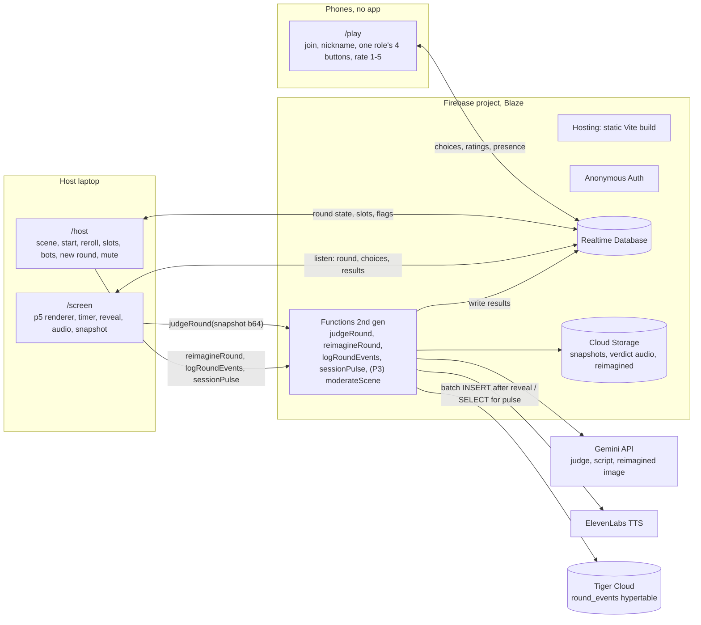
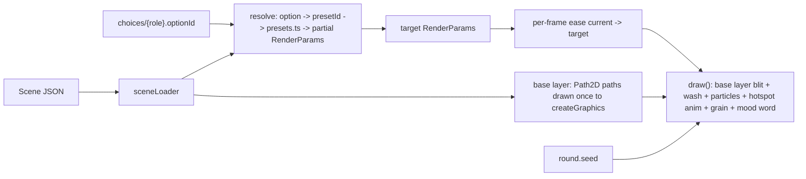

# ARCHITECTURE — Murmuration

> How the system is put together. Decisions referenced as D-nn live in [DECISIONS.md](DECISIONS.md).
> Data shapes: [DATA_SCHEMA.md](DATA_SCHEMA.md). Shared constants and payloads: [CONTRACTS.md](CONTRACTS.md). State transitions: [ROUND_STATE_MACHINE.md](ROUND_STATE_MACHINE.md).

## 1. One-paragraph summary

A single Firebase project hosts everything (D-05). Phones and the host laptop (two windows: `/host` and a fullscreen `/screen`, D-38) are all static pages from one Vite build, talking to one Realtime Database (D-04) under anonymous auth. The host page is the only writer of round state (D-10); phones write only their own tiny records; the screen renders a deterministic p5.js canvas from scene data plus the latest choices (D-20). All external APIs are called only from Cloud Functions after the round locks, each behind a kill-switch flag with a canned fallback (D-02).

## 2. System diagram



## 3. Repository layout

```
murmuration/
  firebase.json            hosting rewrites, functions, database rules path, emulators
  database.rules.json      RTDB security rules (D-31)
  storage.rules
  shared/                  imported by web/ and functions/ (plain TS, no DOM, no node APIs)
    contracts.ts           constants, enums, payload types, callable shapes
    scoring.ts             author / audience / combined formulas
    presets.ts             the preset library: render params per presetId, photosensitivity caps
    scenes/                rush-hour.json, diner.json, vigilante.json
    sceneLoader.ts         validate + normalize a Scene object (bundled or from RTDB)
  web/                     Vite multi-page app (TypeScript, loose)
    screen/  play/  host/  dev/  replay/
    lib/renderer/          p5 sketch, RenderParams, easing, particles, grain, base-art layer
    lib/firebase.ts        app init, anonymous sign-in, server time offset helper
    lib/nick.ts            nickname filter (blocklist + length)
  functions/               Cloud Functions (Node 24, TypeScript)
    judgeRound.ts  reimagineRound.ts  logRoundEvents.ts  sessionPulse.ts  moderateScene.ts (P3)
    lib/gemini.ts  lib/eleven.ts  lib/tiger.ts  lib/flags.ts
    sql/tiger.sql            DDL for the Tiger mirror (run once by hand; see DATA_SCHEMA §8)
  docs/
```

`shared/` must stay free of browser and Node specifics so both bundles can import it. Scenes are plain JSON so a non-dev can edit option labels, author ranks, and prompts in parallel.

## 4. Pages and responsibilities

| Page | Who opens it | Reads | Writes | Notes |
|---|---|---|---|---|
| `/host?s=CODE` | Host, laptop window 2 | everything under the session, `/config/flags` | `meta`, `round`, `players/*` (slot, queuePos, nick override, remove), bot `choices`/`ratings` | The only writer of state transitions. Creates the session (generates code). Shows QR for `/play?s=CODE`. Hosts the "session pulse" panel (Tiger-fed; P1-10), which is a diagnostic tool, never shown on `/screen`. |
| `/screen?s=CODE` | Host laptop window 1, fullscreen (D-38) | `round`, `choices`, `players`, `results` | `results/snapshotRequested` (transaction), calls `judgeRound` | Passive renderer. Plays verdict audio. Can be refreshed at any time (D-20). |
| `/play?s=CODE` | Every phone | `round`, own `players/{uid}`, scene options for own role | own `players/{uid}/nick`, own `choices/{role}`, own `ratings/{uid}` | Three screens: join, Creator (4 big buttons + prompt + timer) or Spectator (waiting / rate / result). |
| `/dev` | Developers | none (local scene JSON) | none | Sliders for every RenderParam, scene picker, "simulate crowd" burst button. Same renderer module as `/screen`. |
| `/replay?s=CODE&r=ROUND` | Anyone with the link | `rounds/{roundId}` | none | Re-runs the event log with the stored seed through the same renderer. OG meta via Hosting rewrite of the share link `/replay/CODE/ROUND` to `replayOg` (P2, CONTRACTS §9). |
| `/studio`, `/gallery` | P3 only | `/scenes`, `/gallery` | own draft scene | See brief §11. Not in the cut. |

## 5. Realtime model and the single-writer rule (D-10)

- **Host writes state.** `round.status`, `round.startsAt`, `round.lockedAt`, `round.ratingEndsAt`, `round.slots`, `round.promptId`, `round.seed`, `players/*/slot`, `players/*/queuePos`. Nobody else may write these; rules check `auth.uid == meta.hostUid`.
- **Phones write themselves.** `players/{uid}/nick` (own uid), `choices/{role}` only if `round.slots[role] == auth.uid` and `now < startsAt + durationMs`, `ratings/{uid}` only if the uid is not in any slot, `round.status == "rating"`, value is an integer 1–5, and the key does not already exist.
- **Functions write `results.ai`, `results.verdict`, and `results.reimagined` only; the host writes `results.author`, `results.audience`, `results.combined` (see ROUND_STATE_MACHINE T3/T5).** Functions use the Admin SDK (bypasses rules; functions validate the caller is the session host or screen by checking `meta.hostUid`/`meta.screenUid`).
- **Presence.** Each client sets `players/{uid}/connected = true` and registers `onDisconnect(...).set(false)` before marking itself online, per the Firebase presence pattern ([offline capabilities](https://firebase.google.com/docs/database/web/offline-capabilities)). The host sees disconnected Creators and can reassign.
- **Time.** Every client reads `.info/serverTimeOffset` once and computes `serverNow() = Date.now() + offset`. The host writes `startsAt = serverNow()` at start; all clients derive `endsAt = startsAt + durationMs`. Rules use `now` (server epoch ms) to reject late choices, so a lagging host clock cannot extend the round for anyone. `serverTimestamp()` is used for `joinedAt`, `at`, `lockedAt`.
- **Why not write the countdown to the DB:** one timestamp plus a derived local countdown is zero writes per second and survives refreshes.

## 6. Rendering pipeline (brief §6, D-16, D-17, D-20)



- **RenderParams** is one flat object of numbers, colors, and a few enums (full list in CONTRACTS §6). Each role's chosen preset contributes a disjoint subset; unfilled roles use the preset library's `neutral` entry for that role, so a 3-Creator round looks intentional.
- **Target vs. current.** On every `choices` change, compute a new `target`. Each frame, `current = lerp(current, target, k)` per numeric field; colors crossfade in a perceptual space; enums switch via a crossfade weight. Default time constants: numerics ~600 ms, palette ~900 ms. Bursts of writes only move `target`; the eye never sees a jump.
- **Base layer.** `createGraphics(w, h)` once per scene; iterate `baseArt.shapes`, build `new Path2D(shape.d)` and `fill`/`stroke` through `g.drawingContext`; then `image(g, 0, 0)` each frame. Hotspot shapes are drawn to their own small graphics so motion presets can translate, pulse, or glow them without redrawing everything.
- **Particles.** One pool, count = `min(cap, adaptive)`; adaptive halves when the rolling frame time exceeds 20 ms and recovers slowly. Behavior (fog, steam, sparks, dust) is a `form` preset parameter set, not a separate class.
- **Determinism.** `randomSeed(seed)` and `noiseSeed(seed)` at round start; all stochastic draws come from p5's `random`/`noise`. Time input is `t = serverNow() - startsAt`, not `millis()`, so replay and a refreshed screen match the original.
- **Performance budget.** `pixelDensity(min(devicePixelRatio, 1.5))`; 1920×1080 internal canvas max; `noSmooth()` off only where needed; no per-frame allocations in the particle loop. Target 60 fps on the laptop; the adaptive particle cap is the only automatic degradation.
- **Photosensitivity.** `presets.ts` is the only place a flicker rate can be defined; the maximum is 3 Hz and the affected area is capped at a fraction of the canvas. Scene JSON cannot set these fields (loader strips unknown override keys).
- **Snapshot.** At LOCKED, after the settle period, `/screen` draws one final frame with `current = target`, exports `canvas.toDataURL("image/jpeg", 0.8)` at 1280×720 (drawn to a temporary graphics), and calls `judgeRound`.
- **Reveal.** Freeze (stop easing), settle (1.5 s), light burst and title card drawn on top; optional small WEBGL shader only for the burst, otherwise 2D.

## 7. Backend: Cloud Functions

All are `onCall` from `firebase-functions/v2/https` ([callable functions](https://firebase.google.com/docs/functions/callable)) so auth context arrives automatically. Secrets via `defineSecret`. Region `us-central1` (same as default Storage bucket for free egress). Each function first loads `/config/flags` and the session's `meta`; if the flag is off or a cap is exceeded it returns the fallback immediately.

| Function | Caller | Does | Timeout |
|---|---|---|---|
| `judgeRound({sessionCode, roundId, snapshotJpegBase64})` | `/screen` | Idempotency transaction on `results/judgeRequestedAt`. Stores snapshot to Storage. One Gemini structured call → `{score, comment, script}` (D-22). Writes `results.ai`, `results.verdict.script`. Then ElevenLabs TTS (cache by script hash, D-25) → `results.verdict.audioUrl`. On any failure, writes canned values and `fallback: true`. | 30 s |
| `reimagineRound({sessionCode, roundId})` | `/host` (auto at reveal if flag on) | Reads the stored snapshot, one Gemini image-editing call with a keep-the-composition prompt (D-36, ≤ 60 s), saves the PNG to Storage, writes its URL to `results.reimagined`. Never blocks the reveal. | 90 s |
| `logRoundEvents({sessionCode, roundId})` | `/host` (fire-and-forget at T5 reveal) | Reads `rounds/{roundId}` (or the live `events` if not yet archived) from RTDB, batch-inserts into the Tiger `round_events` hypertable and one row into `rounds`. Idempotent via `ON CONFLICT DO NOTHING` on `(session_code, round_id, t_ms, role)`. Timeout `TIGER_TIMEOUT_MS` (5 s); failure is logged and ignored, never surfaced to the room. | 15 s |
| `sessionPulse({sessionCode})` | `/host` (poll every 10 s while the panel is open) | `SELECT` from the `choices_10s` continuous aggregate plus two small queries (top option per role, rounds played + average combined). Returns `{buckets, topOptions, rounds}` or `{stale: true}` with the host's last cached payload if Tiger is unreachable. | 10 s |
| `moderateScene({sceneDraft})` (P3) | `/studio` | One Gemini call over screenshot + all text → `{approved, category, reason}`; fail closed. | 20 s |

Functions are the only code holding API keys and the Tiger connection string. Phones never call functions in P0/P1. The Tiger client (`lib/tiger.ts`) is a single `pg.Pool` of size 1–2 with `ssl: { rejectUnauthorized: true }`, created lazily per instance; Tiger is never read or written during `live`.

## 8. Flags, caps, kill switches

`/config/flags` (readable by host and functions, writable only in console or by an admin uid):

```
{ aiEnabled, voiceEnabled, reimagineEnabled, tigerEnabled, studioEnabled,
  maxJudgeCallsPerSession: 20, maxTtsCharsPerSession: 4000, maxReimaginePerSession: 10,
  geminiModel: "gemini-3.8-flash", geminiFallbackModel: "gemini-3.5-flash-lite",
  imageModel: "gemini-nano-banana-2.1", imageFallbackModel: "gemini-3.1-flash-lite-image",
  ttsVoiceId: "<from GET /v1/voices>", ttsModelId: "<from GET /v1/models>" }
```

Per-session counters live in `sessions/{code}/meta/usage`. `/host` shows the flags and lets the host mute voice locally without touching the global flag.

## 9. External services (where each is used, grounded in docs)

- **Firebase RTDB / Auth / Functions / Storage / Hosting.** Rules reference: [database rules](https://firebase.google.com/docs/reference/security/database) (`now`, `auth.uid`, `.validate`). Presence and server time: [offline capabilities](https://firebase.google.com/docs/database/web/offline-capabilities). Storage needs Blaze: [Storage getting started](https://firebase.google.com/docs/storage/web/start).
- **p5.js.** 2D canvas, `createGraphics`, `drawingContext`, `pixelDensity`, `randomSeed`, `noiseSeed`: [p5.js reference](https://p5js.org/reference/).
- **Gemini.** Image understanding with inline base64 (request ≤ 20 MB total): [image understanding](https://ai.google.dev/gemini-api/docs/image-understanding). Structured JSON output: [structured outputs](https://ai.google.dev/gemini-api/docs/structured-output). Model ids: [models](https://ai.google.dev/gemini-api/docs/models). Reimagined render: snapshot + text in, base64 image out via `interactions.create` with `response_format: {type: "image", aspect_ratio: "16:9"}`: [image generation and editing](https://ai.google.dev/gemini-api/docs/image-generation).
- **ElevenLabs.** `POST /v1/text-to-speech/{voice_id}` with `xi-api-key`, body `{text, model_id, voice_settings}`, `output_format` query: [create speech](https://elevenlabs.io/docs/api-reference/text-to-speech/convert).
- **Tiger Data (P1-9/P1-10, D-33).** Tiger Cloud service (managed PostgreSQL + TimescaleDB) reached from Functions with the `pg` driver over TLS; connection string in the `TIGER_DATABASE_URL` secret. One hypertable `round_events`, one plain table `rounds`, one continuous aggregate `choices_10s` with a refresh policy and real-time aggregation so the host panel is current. Written once per round after reveal by `logRoundEvents`; read only by `sessionPulse`. Never on the live path; RTDB remains the source of truth and `/replay` reads RTDB. Docs: [TimescaleDB reference](https://www.tigerdata.com/docs/reference/timescaledb) (hypertables, continuous aggregates, jobs), [continuous aggregates](https://www.tigerdata.com/docs/use-timescale/latest/continuous-aggregates/), [Tiger Cloud getting started](https://www.tigerdata.com/docs/getting-started/latest/). DDL in [DATA_SCHEMA.md §8](DATA_SCHEMA.md).
- **Not used (D-33, D-36, D-37):** Solana, Vultr, Auth0, Adobe Firefly, Adobe Express. Reasons recorded in DECISIONS.

## 10. Environments and deploy

- Local: `firebase emulators:start` (Auth, RTDB, Functions, Storage, Hosting) + `vite dev`. Rules unit tests run against the RTDB emulator.
- Prod: `vite build && firebase deploy`. `main` is always deployable; tags `v0-p0`, `v1` (D-32). Hosting rewrites `/replay/*/*` (the share link) to `replayOg` (P2); `/replay/` itself stays the static page.
- Domain (hour 0, D-34): `mybossdoeslameicebreakers.work`, registered at GoDaddy, added as a custom domain in Firebase Hosting (A/TXT records at GoDaddy DNS), used as the QR destination. Checklist in [SETUP.md](SETUP.md).
