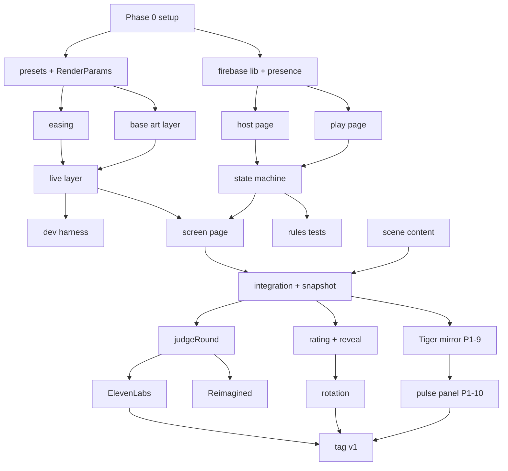

# BUILD_ORDER — Murmuration (36 hours)

> **Active plan: solo, [§8](#8-solo-plan-active-1-dev-26-ph) (D-01).** §1–§7 are the 2-dev reference: use them for task details and verify steps, not for scope.
>
> Person-hours (ph), not wall-clock. 2-dev assumption: 2 devs × ~26 productive hours each = ~52 ph, with sleep and food taken in shifts. Every task names its verify step so "done" is observable.

## 1. Wall-clock timeline

```mermaid
gantt
  dateFormat HH
  axisFormat %H
  title Hour of hackathon (0 = kickoff)
  section Setup
  Phase 0 setup            :p0, 00, 2h
  section P0
  Renderer track (A)       :a1, 02, 16h
  Sync track (B)           :b1, 02, 16h
  Content (scenes)         :c1, 04, 10h
  Checkpoint h10           :milestone, m1, 10, 0h
  Tag v0-p0                :milestone, m2, 18, 0h
  section P1
  Judge + voice + Tiger mirror (B) :b2, 18, 11h
  Scores, reveal, rotation, pulse panel (A) :a2, 18, 11h
  Tag v1 CUT LINE          :milestone, m3, 29, 0h
  section P2
  Picked P2 items          :p2, 29, 1h
  section Freeze
  Freeze, rehearsal, video :f, 30, 4h
  Final deploy             :milestone, m4, 34, 0h
  Buffer                   :buf, 34, 2h
```

## 2. Phase 0 — Setup (h0–h2, 4.5 ph, both devs together)

Accounts, promo codes, and keys follow the ordered checklist in [SETUP.md](SETUP.md); the owner can do most of it before kickoff.

| Task | ph | Verify |
|---|---|---|
| Firebase project on Blaze; enable Anonymous Auth, RTDB, Functions, Storage, Hosting; budget alert $10 | 0.5 | Console shows all five; alert exists |
| Claim sponsor codes and create accounts: ElevenLabs (MLH promo), Gemini (MLH credits + AI Studio key), Tiger Cloud (MLH credits, create service, run `tiger.sql`), GoDaddy domain `mybossdoeslameicebreakers.work` (D-34); set Functions secrets and `/config/flags` | 1 | Each key exists as a secret; `SELECT 1` works against Tiger; domain shows as pending in Firebase Hosting |
| Repo skeleton: Vite MPA with 5 empty pages, `shared/`, `functions/` (Node 24 TS), `firebase.json`, emulators config | 1 | `vite dev` serves `/screen`; `firebase emulators:start` boots |
| `shared/contracts.ts` with every constant from CONTRACTS §1; `shared/scoring.ts` with formulas + an assert-based self-check | 1 | `node scoring.test` passes for trimmed mean, median, empty, author mean |
| Rules skeleton from DATA_SCHEMA; deploy once to prod; tag `v0-skeleton` | 0.5 | `firebase deploy` succeeds; URL loads |
| Run the Gemini structured-output smoke test (R6) and one image-editing call (D-36); pick `ttsVoiceId`/`ttsModelId` from `GET /v1/voices` and `GET /v1/models` | 0.5 | Smoke test returns valid JSON or REST fallback chosen; image call returns a PNG; flags hold voice and model ids |

## 3. Phase 1 — P0 (h2–h18, ~32 ph)

Two parallel tracks that meet at the `RenderParams` + RTDB contracts. Content runs alongside, by whoever is free (or a non-dev teammate).

### Track A — Renderer (Dev A, ~10 ph)

| Order | Task | ph | Verify |
|---|---|---|---|
| A1 | `presets.ts`: 4 presets per role + `neutral`, photosensitivity clamps | 1.5 | Loader rejects an override that sets `motionRateHz` |
| A2 | `RenderParams` resolve: scene + choices → target; easing loop (numeric lerp, palette crossfade) | 1.5 | `/dev` slider jump animates over ~600 ms, no pop |
| A3 | Base-art layer: `Path2D` from scene `d` strings into `createGraphics`, viewBox scaling; hotspot sub-layers | 1.5 | Placeholder scene draws; resizing keeps composition |
| A4 | Live layer: color wash, particle pool (fog/steam/sparks/dust), hotspot motion (pulse/sway/flicker/drift), grain, vignette, mood watermark; seeded random/noise | 3 | Same seed + same events → pixel-identical frames at t=30 s |
| A5 | Performance: DPR cap, adaptive particles, fps counter in `/dev` | 1 | 60 fps at 1080p on the laptop with 1200 particles |
| A6 | `/dev` harness: scene picker, sliders for every param, "simulate crowd" (random target changes every 300 ms for 10 s) | 1.5 | Burst never causes a visual jump |

### Track B — Sync, pages, host (Dev B, ~10 ph)

| Order | Task | ph | Verify |
|---|---|---|---|
| B1 | `lib/firebase.ts`: init, anonymous sign-in, `serverNow()`, presence helper | 0.5 | Two tabs show each other connect/disconnect |
| B2 | `/host`: create session (code), QR (`qrcode` lib) for `/play?s=CODE`, scene picker (bundled 3), duration, player list with rename/remove, assign slot, Add bots | 2.5 | 5 phones join, host reassigns a slot, removed player disappears |
| B3 | `/play`: join with optional nick (filter), Spectator waiting screen, Creator screen with 4 big buttons for own role, countdown, haptics (`navigator.vibrate`) | 2 | Tap writes `choices` + `events` in one update; non-owner write is rejected by rules |
| B4 | State machine on `/host`: T1–T8 with timers, `statusVersion`, multi-path updates, prompt draw/no-repeat/reroll, Author score at lock | 2 | Full lobby→reveal→lobby cycle with bots; refresh host in each state and it resumes |
| B5 | `/screen`: subscribe, render via Track A module, lobby view (QR, counts, dials with nicks), live view (prompt, countdown), lock/settle/reveal visuals, title card | 2 | Screen refresh mid-round re-renders the identical locked frame |
| B6 | Security rules complete + emulator tests: own-nick only, choices only by slot owner inside time window, ratings once/spectator/in window, host-only state | 1 | Rules test file passes (≈12 assertions) |

### Content (≈5 ph, parallel from h4)

| Task | ph | Verify |
|---|---|---|
| Three scenes' base art as SVG paths (rush hour, diner, vigilante), minimal silhouettes, 1–3 hotspots each | 2.5 | Each scene loads in `/dev` and reads clearly from 5 m |
| Option labels (4 per role per scene) + author ranks 10/7/4/1 | 1 | Loader accepts; labels fit 28 chars |
| 8–10 prompts per scene (AI-drafted, hand-reviewed, varied formats, Atlanta humor) | 1.5 | Every prompt is answerable with that scene's options |

### Integration (3 ph, both, h14–h18)

| Task | ph | Verify |
|---|---|---|
| Wire real scenes into `/screen`, `/play`; bots run a full round | 1 | Checkpoint |
| Lock → snapshot JPEG → stored locally (function stub) | 0.5 | File is 1280×720, < 400 KB |
| Read-only gallery list (3 pinned demo entries) as the host's scene picker (solo P0: lists `BUNDLED_SCENES`, no RTDB `/gallery`; see D-39) | 0.5 | Host picks from the list |
| Scripted refresh/disconnect test (RISKS R7) | 1 | All cases in ROUND_STATE_MACHINE §5 pass |

**Checkpoint h10:** one round end-to-end on two phones with placeholder art and no AI.
**Checkpoint h18:** tag `v0-p0`. This build alone is demoable.

## 4. Phase 2 — P1 (h18–h29, ~20 ph)

| Order | Task | Dev | ph | Verify |
|---|---|---|---|---|
| P1-1 | `judgeRound`: flags, caps, snapshot to Storage, Gemini structured call, post-validation, canned fallbacks, idempotency | B | 3 | With `aiEnabled=false` the round still reveals in 12 s; with key, real score appears |
| P1-2 | ElevenLabs in `judgeRound`: cache by hash, fallback clips, `verdict.ready` | B | 2 | Audio plays at reveal; second identical script hits cache |
| P1-3 | Spectator rating UI (1–5), `ratings` rules, "you made this" card for Creators | A | 1.5 | 10 bots vote; trimmed mean matches `scoring.ts` |
| P1-4 | Three-score reveal: author, AI, audience, combined; credits per dial; adaptive rating window; verdict playback with manual Play | A | 2.5 | Scores animate in; audio unlock works after one click |
| P1-5 | Role rotation on New round (queue), late-joiner handling | A | 1 | 8 players, 2 rounds: everyone has been a Creator by round 2 |
| P1-6 | Reveal polish: light burst, title card, short sound cue | A | 1 | Looks intentional on the laptop screen from ~2 m |
| P1-7 | Gemini `reimagineRound` (D-36): snapshot from Storage, one image-editing call, PNG to Storage, `results.reimagined`, side-by-side panel; tune the prompt on a real snapshot | B | 2 | Side-by-side appears within 60 s or is skipped silently |
| P1-8 | Pre-generate fallback verdict clips (script per scene × 3) the moment an ElevenLabs key exists | B | 1 | Files in Storage; fallback path plays them |
| P1-9 | **Tiger mirror** (D-33): `lib/tiger.ts` pool + `logRoundEvents` callable (batch insert, `ON CONFLICT DO NOTHING`, 5 s timeout, `tigerEnabled` flag), host calls it at T5 and retries once at NEW_ROUND | B | 3 | After a bot round, `SELECT count(*) FROM round_events WHERE round_id = ...` equals the RTDB event count; with Tiger unreachable the reveal is unaffected |
| P1-10 | **Session pulse panel** on `/host`: `sessionPulse` callable over `choices_10s` + top option per role + rounds played; small bar sparkline per role, polled every 10 s, `stale` badge when Tiger is down | A | 2 | Panel updates within 20 s of a reveal; nothing appears on `/screen` |

**Tag `v1` at h29. CUT LINE for 2 devs.** Everything below is optional. If P1-1..P1-8 slip past h27, P1-10 is the first thing dropped (the mirror alone still qualifies for the Tiger track).

## 5. Phase 3 — P2 (h29–h30, pick by value/cost)

| Item | ph | Value | Pick order |
|---|---|---|---|
| `/replay` page from `rounds/{id}` (same renderer) | 2 | Strong demo talking point, cheap because renderer is deterministic | 1 |
| OG preview for replay link (Hosting rewrite to a tiny function that injects `og:image`) | 1 | Needed for unfurls | 2 |
| p5 poster PNG from `/host` (D-37) | 1.5 | Shareable "poster" of the round | 3 |
| Static narration audio for demo mode (ElevenLabs, generated once) | 2 | Helps a solo presenter; strengthens the ElevenLabs entry | 4 |
| Spectator energy dial (throttled writes) | 2 | Nice, not needed | 5 |

The domain (formerly here) moved to Phase 0; the Tiger mirror moved to P1-9/P1-10.

## 6. Phase 4 — P3 Scene Studio lite (10–14 ph)

Not reachable with 2 devs under this plan. Only if Phase 3 is complete by h30, which is unlikely. Order if attempted: preset picker + ranking (2) → polyline brush + shapes + undo (4) → `moderateScene` fail-closed (2) → gallery write + play counter (1) → prompt suggestions (1) → rate limits (1). Otherwise it is a roadmap slide, and the pitch says so plainly.

## 7. Freeze and rehearsal (h30–h36)

| Hour | Action |
|---|---|
| h30 | Feature freeze. Only bug fixes. Record the full backup run on the demo laptop. |
| h31–h33 | Rehearse the pitch with a live round; test on venue WiFi and on the hotspot; verify audio unlock; run the pre-demo checklist (RISKS §3). |
| h34 | Final `firebase deploy`; tag `v-final`; smoke test from a phone. |
| h34–h36 | Touch nothing. Submission text, video upload, sleep. |

## 8. Solo plan (active, 1 dev, ~26 ph)

| Hours | Build | Cut |
|---|---|---|
| h0–h2 | Phase 0 as above (2.5 ph; the SETUP.md account work is done before kickoff, domain included) | — |
| h2–h16 | B1–B6 and A1–A5 for **three roles only** (palette, form, motion); texture and mood use fixed neutral presets; no hotspots (base art static); `/dev` minimal; one scene fully authored, two with placeholder art and real labels/prompts | A6 crowd sim, hotspots, 2 of 3 scenes' art |
| h16–h22 | Rating UI + author score + three-score reveal (P1-3, P1-4 minus polish) + `judgeRound` with Gemini only (P1-1) | Voice, Reimagined, rotation polish |
| h22–h26 | Rotation (P1-5), bots, refresh test, Tiger mirror only (P1-9, no panel), recorded backup | P1-10 pulse panel |
| h26–h30 | If ahead: ElevenLabs (P1-2); else: canned scripts shown as text | Everything in P2/P3 |
| h30–h36 | Freeze, rehearsal, deploy | — |

Solo cut line: **P0 (3 roles) + Gemini judge + audience rating + author score + Tiger mirror.** The mirror stays in because it is ~3 ph for a whole prize category; the domain stays because it is 0 build hours.

## 9. Dependency order (what blocks what)



## 10. Done means

- A stranger can scan the QR, pick a role, change a dial, see the big screen move smoothly, watch it lock, rate it, hear a verdict (real or canned), and see three scores with their name on the dial they controlled.
- The host can refresh at any moment and nothing breaks.
- Every external key can be absent and the demo still runs.
- Sponsor entries are truthful: ElevenLabs speaks the verdict, Gemini judges, Tiger holds the event log and feeds the host panel, the QR points at the GoDaddy domain (D-33).
