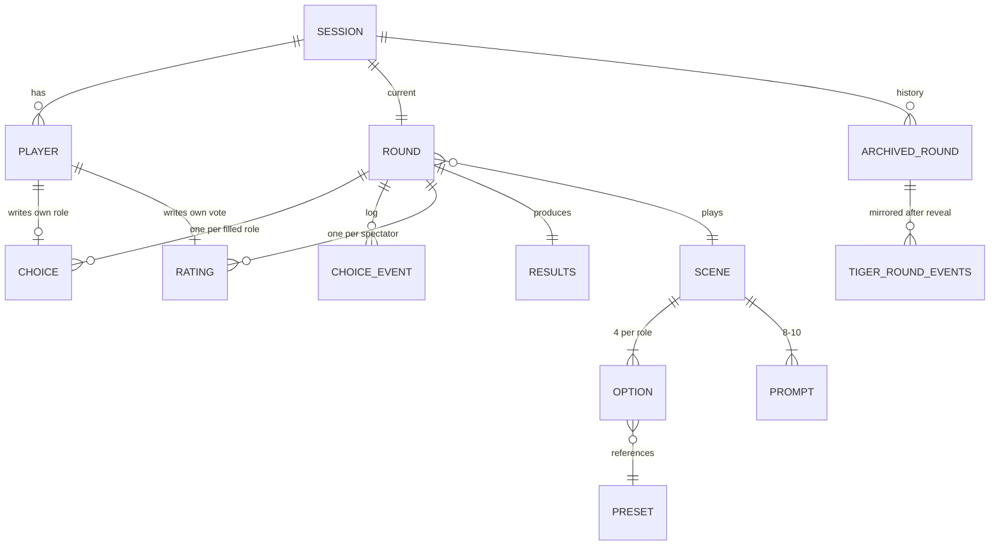

# DATA_SCHEMA — Murmuration

> Every stored shape: Realtime Database paths, bundled scene JSON, Cloud Storage objects. Rule intent per path (the actual `database.rules.json` is derived from this).
> Types are TypeScript-ish; all live in `shared/contracts.ts`. Timestamps are epoch ms written with `serverTimestamp()` unless noted.

## 1. Realtime Database tree

```
/config/flags                         global kill switches and caps
/sessions/{code}/
  meta                                session identity, host, usage counters
  players/{uid}                       everyone who scanned the QR
  round                               the current round only (one at a time)
  choices/{role}                      latest choice per role (current round)
  events/{pushId}                     append-only choice log (current round)
  ratings/{uid}                       spectator votes (current round)
  results                             scores, verdict, snapshot, reimagined (current round)
  rounds/{roundId}                    archive: snapshot of round+choices+events+ratings+results at reset
/scenes/{sceneId}                     P3: user-made scenes (demo scenes are bundled, not stored here)
/gallery/{sceneId}                    P3 + P0-lite: list entries the host picker reads
/reports/{pushId}                     P3: scene reports
```

`code` is 4 uppercase letters/digits excluding `0 O 1 I`. Everything for one session is under one subtree so a single `onValue` on `/sessions/{code}/round` plus a few siblings is all a client needs.

## 2. `/config/flags`

```ts
type Flags = {
  aiEnabled: boolean;          // judgeRound calls Gemini
  voiceEnabled: boolean;       // judgeRound calls ElevenLabs
  reimagineEnabled: boolean;   // reimagineRound calls the Gemini image model (D-36)
  tigerEnabled: boolean;       // logRoundEvents writes to Tiger; sessionPulse reads
  studioEnabled: boolean;      // P3 routes visible
  maxJudgeCallsPerSession: number;   // default 20
  maxTtsCharsPerSession: number;     // default 4000
  maxReimaginePerSession: number;    // default 10
  geminiModel: string;               // "gemini-3.8-flash"
  geminiFallbackModel: string;       // "gemini-3.5-flash-lite"
  imageModel: string;                // "gemini-nano-banana-2.1"
  imageFallbackModel: string;        // "gemini-3.1-flash-lite-image"
  ttsVoiceId: string;                // chosen at hour 0 from GET /v1/voices (O-05)
  ttsModelId: string;                // chosen at hour 0 from GET /v1/models (O-05)
}
```
Rules: `.read` any signed-in user; `.write` only `auth.uid` in a hard-coded admin list (team uids) or via console.

## 3. Session

### `/sessions/{code}/meta`
```ts
type SessionMeta = {
  hostUid: string;             // creator of the session, the single state writer
  screenUid?: string;          // uid of the /screen client (set by host after screen pairs), may call judgeRound
  sceneId: string;             // currently selected scene ("rush-hour" | "diner" | "vigilante" | custom id)
  createdAt: number;
  usedPromptIds: Record<string, true>;  // per scene reroll/no-repeat tracking, keyed `${sceneId}:${promptId}`
  usage: { judgeCalls: number; ttsChars: number; reimagineCalls: number };  // written by functions only
  roundCounter: number;        // increments on each new round; roundId = `r${roundCounter}`
}
```
Rules: `.read` signed-in. `.write` only when `!data.exists()` (create, sets `hostUid == auth.uid`) or `auth.uid == data.hostUid`. `usage` writable only by Admin SDK (no client rule).

### `/sessions/{code}/players/{uid}`
```ts
type Player = {
  nick: string;                // 1-16 chars post-filter; default "Guest-xxxx" if blank
  joinedAt: number;
  connected: boolean;          // presence; onDisconnect sets false
  lastSeen: number;            // onDisconnect sets serverTimestamp
  role: "creator" | "spectator";
  slot: Role | null;           // which dial, if creator (host-written)
  queuePos: number;            // rotation order (host-written); lower = sooner
  isBot?: true;                // demo-mode bots (host-written)
  removed?: true;              // host removed; client shows "removed by host"
}
```
Rules:
- `.read` signed-in.
- `nick`, `connected`, `lastSeen`, `joinedAt`: `.write` if `$uid == auth.uid` or `auth.uid == meta.hostUid`.
- `role`, `slot`, `queuePos`, `isBot`, `removed`: `.write` only `auth.uid == meta.hostUid`.
- `.validate nick`: `newData.isString() && newData.val().length >= 1 && newData.val().length <= 16`. The blocklist runs client-side on `/play` and again on `/host` (the host sees every nick before it is displayed on the screen and can rename/remove; the screen only displays nicks of players with `removed != true`). Rules cannot run a word list.
- Bots: uid pattern `bot_{n}`; host writes the whole record. Rules allow `auth.uid == meta.hostUid` to write any `players/bot_*`.

## 4. Round

### `/sessions/{code}/round`
```ts
type Role = "palette" | "form" | "motion" | "texture" | "mood";
type RoundStatus = "lobby" | "live" | "locked" | "rating" | "reveal";

type Round = {
  id: string;                  // "r1", "r2", ...
  sceneId: string;
  promptId: string | null;     // drawn at start
  promptText: string | null;   // denormalized so phones need not load the scene
  seed: number;                // 32-bit int, set at start
  durationMs: 60000 | 90000 | 120000;
  status: RoundStatus;
  startsAt: number | null;     // host's serverNow() at start; endsAt = startsAt + durationMs (derived, never stored)
  lockedAt: number | null;
  ratingEndsAt: number | null; // host sets at RATING entry = lockedAt + settle + 12000; may extend to +25000
  slots: Partial<Record<Role, string>>;  // role -> uid, filled in priority order
  statusVersion: number;       // increments on every status change; clients ignore stale callbacks
}
```
Rules: `.read` signed-in. `.write` only `auth.uid == meta.hostUid`. `.validate`: `status` in the enum; `durationMs` in the set; `slots/{role}` keys in the Role set and values are existing `players/{uid}` keys.

### `/sessions/{code}/choices/{role}`
```ts
type Choice = { optionId: string; uid: string; at: number }
```
Rules:
- `.read` signed-in.
- `.write`: `root.child('sessions/'+$code+'/round/status').val() == 'live'`
  `&& root.child('sessions/'+$code+'/round/slots/'+$role).val() == auth.uid`
  `&& now < root.child('sessions/'+$code+'/round/startsAt').val() + root.child('sessions/'+$code+'/round/durationMs').val()`
  OR `auth.uid == meta.hostUid` (bots, reset).
- `.validate`: `newData.child('uid').val() == auth.uid || auth.uid == hostUid`; `optionId` is a string ≤ 32 chars. Validating that `optionId` belongs to the scene is done client-side and by `judgeRound` (unknown ids fall back to the role's neutral preset).
- Last write wins; this is the brief's "soft undo".

### `/sessions/{code}/events/{pushId}`
```ts
type ChoiceEvent = { t: number; role: Role; optionId: string; uid: string }
// t = ms since round.startsAt, computed client-side from serverNow(); clamped to [0, durationMs]
```
Rules: `.write` only `!data.exists()` (append-only) and same guard as `choices`. `.validate`: `t` number, `role` in set, `optionId` ≤ 32 chars. The phone writes `choices/{role}` and `events/{push}` in one multi-path `update()`.

### `/sessions/{code}/ratings/{uid}`
```ts
type Rating = number;  // integer 1..5
```
Rules:
- `.write`: `$uid == auth.uid && !data.exists()`
  `&& round/status == 'rating'`
  `&& now < round/ratingEndsAt + 3000` (3 s grace for latency)
  `&& players/{uid}/role == 'spectator'`  (not a Creator this round)
  OR `auth.uid == hostUid` (bot votes).
- `.validate`: `newData.isNumber() && newData.val() >= 1 && newData.val() <= 5 && newData.val() == Math.floor(newData.val())` (RTDB rules have no `Math`; use `newData.val() in [1,2,3,4,5]` via explicit `||` comparisons).

### `/sessions/{code}/results`
```ts
type Results = {
  judgeRequestedAt?: number;   // idempotency marker (transaction by /screen)
  snapshotUrl?: string;        // Storage download URL
  author?: { score: number; perRole: Partial<Record<Role, number>> };     // computed by /host at lock, 0-10
  ai?: { score: number; comment: string; model: string; fallback: boolean };  // 1-10
  audience?: { score: number | null; count: number; method: "trimmed" | "median" | "none" };  // 0-10, by /host at reveal
  combined?: number | null;    // by /host at reveal
  verdict?: { script: string; audioUrl: string | null; ready: boolean; fallback: boolean };
  reimagined?: { status: "pending" | "ready" | "failed" | "skipped"; url?: string };  // url = Storage download URL, never image data
}
```
Rules: `.read` signed-in. `author`, `audience`, `combined`: `.write` host only. `judgeRequestedAt`: `.write` `auth.uid == hostUid || auth.uid == meta.screenUid`, and `!data.exists()`. Everything else written by Admin SDK only.

### `/sessions/{code}/rounds/{roundId}`
Exact copy of `{round, choices, events, ratings, results, playersSnapshot}` taken by `/host` at "new round", where `playersSnapshot` is `{uid: {nick, slot}}` for credits and replay. Rules: host write only; read signed-in (replay links use anonymous auth too). P2 replay reads only this subtree.

## 5. Scene content

### Scene (bundled JSON in `shared/scenes/*.json`, same shape at `/scenes/{sceneId}` for P3)
```ts
type Scene = {
  id: string;                  // "rush-hour"
  title: string;               // "Atlanta Rush Hour"
  author: string;              // "Team Murmuration" or nickname for custom
  kind: "demo" | "custom";
  version: 1;
  baseArt: {
    viewBox: [number, number, number, number];   // SVG viewBox the paths are authored in; renderer scales to canvas
    background: string;        // hex, drawn under the color wash
    shapes: Shape[];
  };
  options: Record<Role, Option[]>;   // exactly 4 per role for demo; 4 per role for custom
  prompts: Prompt[];           // 8-10 for demo, 1-3 for custom
  createdAt?: number;          // custom only
  authorUid?: string;          // custom only
  moderation?: { approved: boolean; category: string; reason: string; at: number };  // custom only
}

type Shape = {
  d: string;                   // SVG path data
  fill?: string;               // hex or "none"
  stroke?: string;
  strokeWidth?: number;
  hotspot?: string;            // tag, e.g. "brakeLights", "sign", "searchlight"; demo scenes only
}

type Option = {
  id: string;                  // "pal-brake-red", unique within the scene
  presetId: string;            // key in shared/presets.ts for this role
  label: string;               // "Brake-Light Red", ≤ 28 chars
  authorScore: 10 | 7 | 4 | 1; // ranking; each value used once per role
  overrides?: Record<string, number | string>;  // demo scenes only; loader strips protected keys
}

type Prompt = { id: string; text: string }   // text ≤ 120 chars
```

Loader rules (`shared/sceneLoader.ts`): reject if any role has ≠ 4 options; reject duplicate `authorScore` within a role; strip `overrides` and `hotspot` when `kind == "custom"`; strip any override key listed in `PROTECTED_PARAMS` (flicker rate, flicker area, strobe) for every scene; reject unknown `presetId`.

### Preset library (`shared/presets.ts`, code, not data)
```ts
type Preset = {
  id: string;                  // "pal-sodium", "form-fog", "motion-pulse", "tex-grain-heavy", "mood-hush"
  role: Role;
  params: Partial<RenderParams>;   // the subset this role owns
  label?: string;              // default label for Scene Studio pickers
}
```
Each role also has a `neutral` preset used when the slot is unfilled. The library is the only P3→P0 seam (D-17); Scene Studio picks from it, demo scenes reference it.

## 6. Gallery and Studio (P3; the P0 host picker reads the pinned entries)

### `/gallery/{sceneId}`
```ts
type GalleryEntry = {
  title: string; author: string; kind: "demo" | "custom";
  approved: boolean;           // demo entries are seeded true
  pinned: boolean;             // demo scenes true
  plays: number;               // incremented by host at round start (transaction)
  createdAt: number;
  authorUid?: string;
}
```
Rules: `.read` signed-in; demo entries seeded by console; custom entries written by `moderateScene` (Admin SDK) only; `plays` writable by any signed-in user via `+1` validation (`newData.val() == data.val() + 1`).

### `/scenes/{sceneId}` (custom)
Full `Scene` object. Rules: `.read` if `approved == true` or `authorUid == auth.uid`; `.write` only `authorUid == auth.uid` while `moderation` does not exist (draft), limit one write per 60 s per uid via a `lastWriteAt` field validated against `now`, and max 5 scenes per uid tracked under `/userScenes/{uid}/{sceneId}`. Publishing (`moderation.approved = true`) is Admin SDK only.

### `/reports/{pushId}`
`{ sceneId, reporterUid, at, reason? }`. Rules: append-only, signed-in.

## 7. Cloud Storage objects

| Path | Written by | Content | Public? |
|---|---|---|---|
| `snapshots/{code}/{roundId}.jpg` | `judgeRound` | 1280×720 JPEG | read via download URL (token), used by `/replay` OG and the p5 poster |
| `verdicts/{sha256(script)}.mp3` | `judgeRound` | ElevenLabs output | read via download URL |
| `reimagined/{code}/{roundId}.png` | `reimagineRound` | Gemini image output, 16:9 | read via download URL |
| `fallback/{sceneId}/{n}.mp3` | pre-generated by a script, uploaded manually | canned verdicts | read |
| `narration/*.mp3` (P2) | pre-generated | demo walkthrough | read |

Storage rules: no client writes; reads allowed for `snapshots/**`, `verdicts/**`, `reimagined/**`, `fallback/**`, `narration/**`.

## 8. Tiger Data mirror (derived store, D-33)

RTDB is the source of truth. Tiger Cloud (managed PostgreSQL + TimescaleDB) holds a copy of each archived round's event log so the host can show a live "session pulse" and so the project has a real time-series story. Written once per round after reveal by `logRoundEvents`; read only by `sessionPulse`. If Tiger is down, nothing in the game changes.

DDL (`functions/sql/tiger.sql`, run once from the Tiger console or `psql`). Grounded in the [TimescaleDB reference](https://www.tigerdata.com/docs/reference/timescaledb) and [continuous aggregates docs](https://www.tigerdata.com/docs/use-timescale/latest/continuous-aggregates/):

```sql
-- one row per Creator choice; time = round.startsAt + t_ms
CREATE TABLE round_events (
  time         timestamptz NOT NULL,
  session_code text        NOT NULL,
  round_id     text        NOT NULL,
  role         text        NOT NULL,      -- palette | form | motion | texture | mood
  option_id    text        NOT NULL,
  uid_hash     text        NOT NULL,      -- first 8 hex of sha256(uid); never a nickname
  t_ms         integer     NOT NULL,      -- ms since startsAt
  UNIQUE (session_code, round_id, t_ms, role, time)  -- hypertable unique keys must include time
) WITH (tsdb.hypertable);                 -- partitions on the first timestamptz column

-- one row per archived round
CREATE TABLE rounds (
  session_code text        NOT NULL,
  round_id     text        NOT NULL,
  scene_id     text        NOT NULL,
  prompt_id    text,
  duration_ms  integer     NOT NULL,
  creators     smallint    NOT NULL,      -- filled slots (up to 3)
  author       numeric(4,1),
  ai           numeric(4,1),
  audience     numeric(4,1),
  combined     numeric(4,1),
  locked_at    timestamptz NOT NULL,
  PRIMARY KEY (session_code, round_id)
);

-- choices per 10 s bucket per role, auto-refreshed; feeds the /host pulse panel
CREATE MATERIALIZED VIEW choices_10s
WITH (timescaledb.continuous, timescaledb.materialized_only = false) AS
SELECT time_bucket('10 seconds', time) AS bucket, session_code, role, count(*) AS n
FROM round_events
GROUP BY bucket, session_code, role
WITH NO DATA;

SELECT add_continuous_aggregate_policy('choices_10s',
  start_offset => INTERVAL '1 hour', end_offset => INTERVAL '10 seconds', schedule_interval => INTERVAL '10 seconds');
```

Notes:
- `WITH (tsdb.hypertable)` is the `CREATE TABLE` form shown in the continuous-aggregates docs; if the service's TimescaleDB version predates it, use `SELECT create_hypertable('round_events', 'time');` instead (*verify at setup*).
- Queries used by `sessionPulse`: last 15 min of `choices_10s` for the session; `SELECT role, option_id, count(*) ... GROUP BY role, option_id ORDER BY count DESC` with `DISTINCT ON (role)`; `SELECT count(*), avg(combined), max(locked_at) FROM rounds WHERE session_code = $1`.
- Retention is not needed for a weekend; the $1,000 MLH credit is valid 30 days.
- Mapping from RTDB: `rounds/{roundId}/events/{push}` → one `round_events` row; `rounds/{roundId}/results` + `round` → one `rounds` row.

## 9. Entity relationship summary



## 10. Size budget (keeps WiFi happy)

| Record | Typical bytes |
|---|---|
| `choices/{role}` write (multi-path with event) | < 150 |
| `ratings/{uid}` | < 10 |
| `players/{uid}` | < 120 |
| `round` | < 600 |
| `results` (without URLs) | < 1 KB |
| Demo scene JSON (paths included) | ≤ 200 KB, loaded once from the bundle, not from RTDB |
| Custom scene JSON | ≤ 50 KB |

Phones never subscribe to `events` or `rounds`; only `/screen`, `/host`, and `/replay` do.
