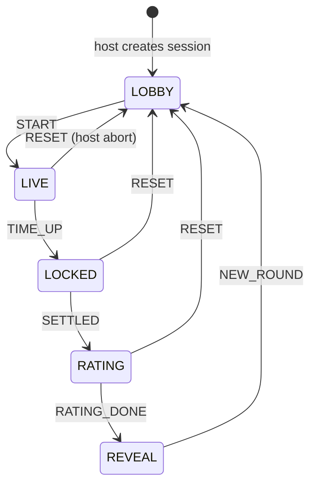

# ROUND_STATE_MACHINE — Murmuration

> The one state machine every page derives its UI from. `/host` is the only writer of `round.status` (D-10). All times are server epoch ms; every client computes `serverNow() = Date.now() + serverTimeOffset`.

## 1. States



| Status | What the room sees | Who may write what |
|---|---|---|
| `lobby` | Screen: QR, scene title, "Creators 3/5 joined", nick list with dials. Phones: join form, then "You are the Palette" or "You're a Spectator, get ready to rate". Host: scene picker, slot assignment, rename/remove, duration, Add bots, Start. | Host: everything. Phones: own `nick`, presence. |
| `live` | Screen: canvas evolving, prompt, countdown, dial owners. Creators: 4 big buttons, current pick highlighted, countdown. Spectators: "Watch the screen", countdown. | Creators: own `choices/{role}` + `events`. Host: nothing except RESET. |
| `locked` | Screen: easing stops, settle, light burst, title card. Phones: "Locked!" | Screen: `results/judgeRequestedAt` transaction, calls `judgeRound`. Host: `results.author`. |
| `rating` | Screen: locked art, "The room is judging...", spinner for judge. Spectators: five buttons, then "Thanks". Creators: "You made this" card with their dial. | Spectators: own `ratings/{uid}`. Functions: `results.ai`, `results.verdict`. Host: `ratingEndsAt` extension. |
| `reveal` | Screen: three scores animate in, combined, verdict audio plays, credits by dial, Reimagined panel if ready. Phones: scores + "Next round soon". | Host: `results.audience`, `results.combined`, Reimagined trigger, New round. |

## 2. Transition table

| # | Transition | Trigger (evaluated on `/host`) | Guard | Host writes (one multi-path `update`) |
|---|---|---|---|---|
| T1 | create → `lobby` | Host opens `/host` without a code | none | `meta{hostUid, sceneId: "rush-hour", createdAt, roundCounter: 0}`, `round{id:"r0", status:"lobby", durationMs: 90000, slots:{}, statusVersion: 0}` |
| T2 | `lobby` → `live` (START) | Host taps Start | filled slots ≥ 3 (humans or bots); scene loaded; at least one unused prompt (else reset `usedPromptIds` for the scene) | `round{id: r{n+1}, sceneId, promptId, promptText, seed: random 32-bit, startsAt: serverNow(), status:"live", statusVersion+1}`, `choices: null`, `events: null`, `ratings: null`, `results: null`, `meta.usedPromptIds[...]: true`, `meta.roundCounter: n+1`, `players/*/role` set from slots |
| T3 | `live` → `locked` (TIME_UP) | Host timer: `serverNow() >= startsAt + durationMs` | status still `live` | `round{status:"locked", lockedAt: serverNow(), statusVersion+1}`, `results.author` computed from `choices` × scene author scores |
| T4 | `locked` → `rating` (SETTLED) | Host timer: `serverNow() >= lockedAt + SETTLE_MS (1500)` | status still `locked` | `round{status:"rating", ratingEndsAt: serverNow() + RATING_MIN_MS (12000), statusVersion+1}` |
| T4a | (side effect, on `/screen`) | `/screen` observes `locked` and ≥ SETTLE_MS elapsed | `results/judgeRequestedAt` transaction succeeds (was null) | `/screen` renders final frame with `current = target`, captures JPEG, calls `judgeRound` |
| T5 | `rating` → `reveal` (RATING_DONE) | Host timer: `serverNow() >= ratingEndsAt` | if `results.verdict.ready != true` and `serverNow() < lockedAt + SETTLE_MS + RATING_MAX_MS (25000)`: instead extend `ratingEndsAt += 3000` and stay; otherwise proceed (verdict falls back to canned if not ready) | `round{status:"reveal", statusVersion+1}`, `results.audience` from `ratings` (trimmed mean/median, see CONTRACTS), `results.combined`; if `reimagineEnabled` and not yet started, call `reimagineRound` |
| T6 | `reveal` → `lobby` (NEW_ROUND) | Host taps New round | none | `rounds/{roundId}` = copy of `{round, choices, events, ratings, results, playersSnapshot}`; rotate queue (§4); assign new slots; `round{id: same until next START, status:"lobby", startsAt:null, lockedAt:null, ratingEndsAt:null, promptId:null, slots: new, statusVersion+1}`; `choices/events/ratings/results: null`; `players/*/role` updated |
| T7 | any → `lobby` (RESET) | Host taps Reset (confirm dialog) | none | same as T6 but without archiving and without rotation: slots and `queuePos` stay (D-42); `usedPromptIds` for that prompt removed so it can be redrawn |
| T8 | `lobby` reroll | Host taps Reroll | status `lobby`; another unused prompt exists | Only `round.promptId/promptText` and `usedPromptIds` (previous prompt stays used). Note: the brief draws the prompt at start; we draw it at START but allow a *preview* in lobby so reroll has something to reroll. The preview prompt becomes the round prompt at START. |

Timers on `/host` are `requestAnimationFrame`/`setInterval(250)` checks against `serverNow()`, not `setTimeout` for the full duration, so sleeping tabs and refreshes still fire the transition late but correctly.

## 3. Time anchors

```
startsAt ──── durationMs ────► endsAt ─ settle 1.5 s ─► ratingStart ─ 12..25 s ─► reveal
   │                              │                          │
   │ rules: choices allowed       │ lockedAt                 │ ratingEndsAt (extends in 3 s steps until verdict.ready, max 25 s total)
```

- `endsAt` is never stored; it is `startsAt + durationMs` everywhere, including rules (`now < startsAt + durationMs`).
- Phones show `max(0, endsAt - serverNow())`; the screen shows the same number, so the room never sees two different countdowns.
- A 3 s grace on `ratings` writes (`now < ratingEndsAt + 3000`) absorbs phone latency.

## 4. Slot assignment and rotation (D-12)

- Queue = all non-removed humans sorted by `queuePos`; bots are appended only if humans < 3 and host enabled Add bots.
- On NEW_ROUND: current Creators get `queuePos = max + 1 .. +5` (back of the line); the first up-to-5 in queue order get slots in priority order `palette, form, motion, texture, mood`.
- Host overrides: "Assign to Palette" sets `slots.palette = uid` and `queuePos` of that uid to the front; the displaced uid returns to its previous position.
- Late joiners during `live` are Spectators for the round and get `queuePos = max + 1`.
- Disconnected Creator during `live`: nothing changes automatically (their last choice stands; the role's neutral preset applies if they never chose). The host sees a red dot and may reassign the slot to the next queued Spectator; the new Creator's phone switches to the Creator screen on the next `round` snapshot. Rules let the new uid write because `slots[role]` changed.

## 5. Recovery rules (brief §15)

| Event | Behaviour |
|---|---|
| **Host refresh mid-round** | `/host` loads `round`; if `status == live` and `serverNow() >= endsAt` it runs T3 immediately; if `locked` and settle elapsed, T4; if `rating` and `ratingEndsAt` passed, T5. Nothing is lost because all state is in RTDB and derived from timestamps. `statusVersion` prevents a stale listener callback from double-writing. |
| **Screen refresh mid-round** | Re-subscribes, re-renders from `scene + seed + choices + t`. Easing starts from the target (no catch-up animation). If `status == locked/rating` and `judgeRequestedAt` is null, it performs T4a; if not null, it just waits for `results`. |
| **Phone refresh / reconnect** | Anonymous auth uid persists in the browser, so `players/{uid}` and the slot survive. `/play` re-reads `round` and shows the right screen. `.info/connected` false shows a "Reconnecting" banner and disables buttons. |
| **Creator disconnects** | See §4. Their last choice remains; the piece still completes. |
| **Nobody joins** | Host taps Add bots (3 or 5). Bots pick a random option at `t ≈ 5 s` and change once or twice; bot Spectators vote 3–5. Everything else is identical. |
| **Two phones claim a role** | Impossible by construction: only the host writes `slots`, and rules check `slots[role] == auth.uid`. |
| **Near-simultaneous choice writes** | Each role is a separate key written by exactly one uid; last write wins; `events` are append-only so the log keeps both. |
| **Join storm** | Joins are single small writes under distinct keys; the host only reads. The screen lists at most 5 Creators and a count of Spectators. |
| **Judge call fails or times out** | `judgeRound` writes canned `ai` and `verdict{fallback:true, ready:true}`; T5 proceeds at the minimum window. |
| **Host closes laptop** | Session persists; reopening `/host?s=CODE` resumes. Host uid must match `meta.hostUid`; the host page stores the code in `localStorage`. |

## 6. What each page subscribes to

| Page | Listeners |
|---|---|
| `/host` | `round`, `players`, `choices`, `ratings`, `results`, `/config/flags`, `.info/serverTimeOffset` |
| `/screen` | `round`, `choices`, `players` (nicks for dials), `results`, `.info/serverTimeOffset` |
| `/play` | `round`, own `players/{uid}`, `.info/connected`, `.info/serverTimeOffset`; after reveal, `results` (scores only) |

Phones never listen to `choices`, `events`, `ratings`, or `rounds`.
